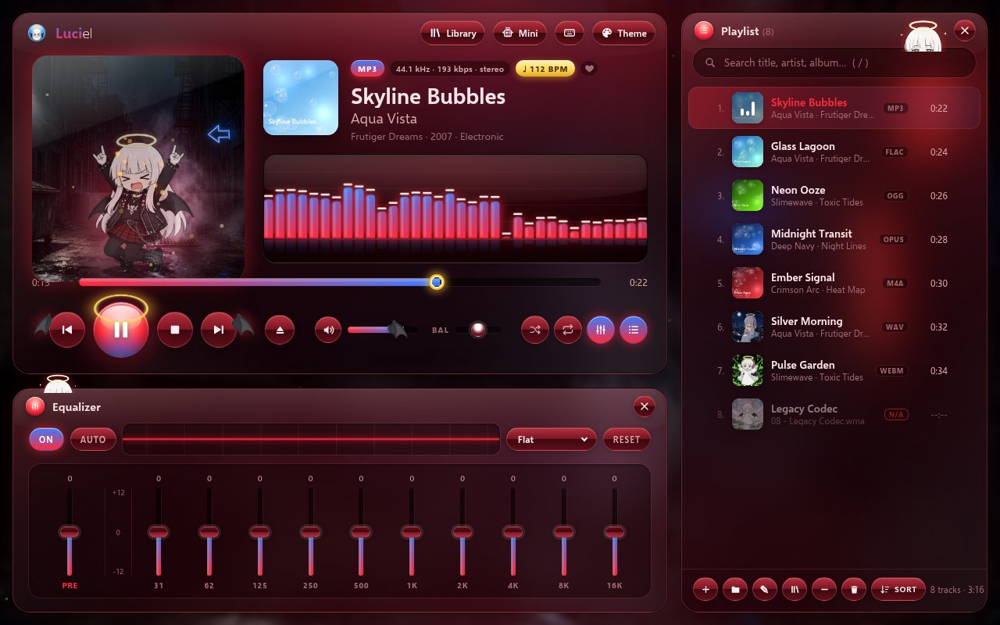
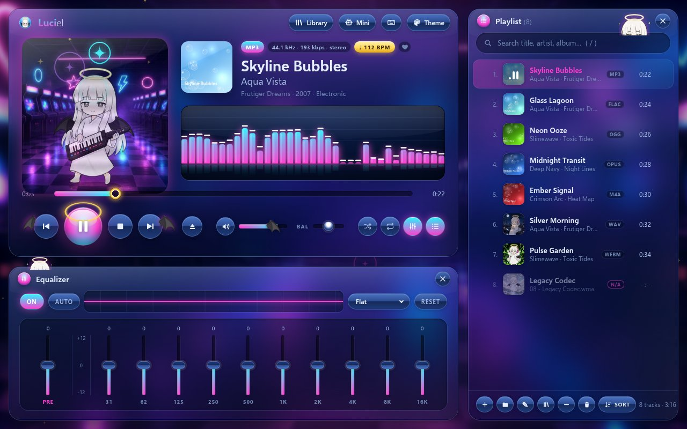
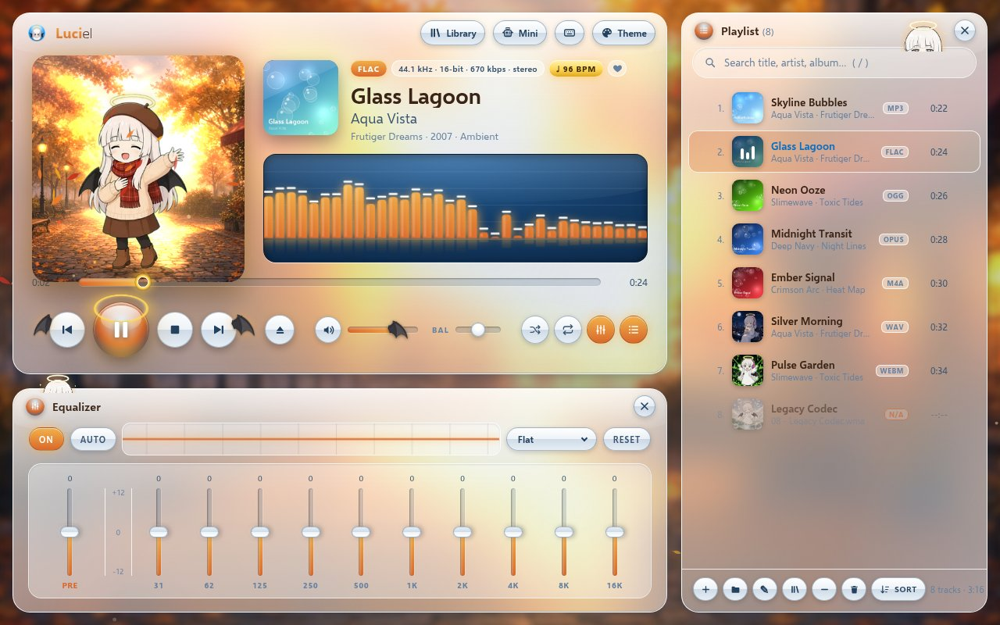
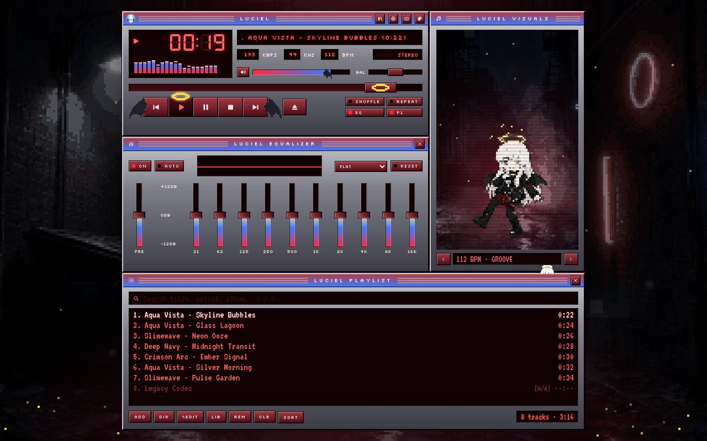
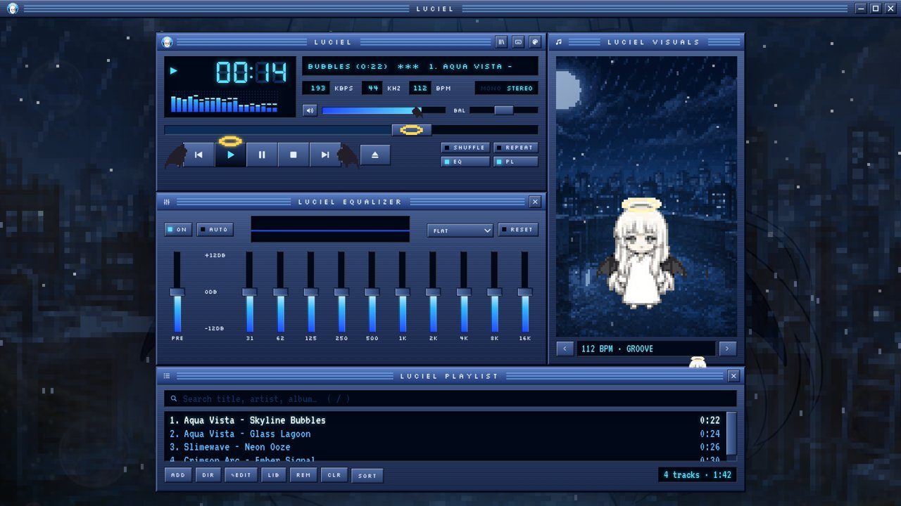
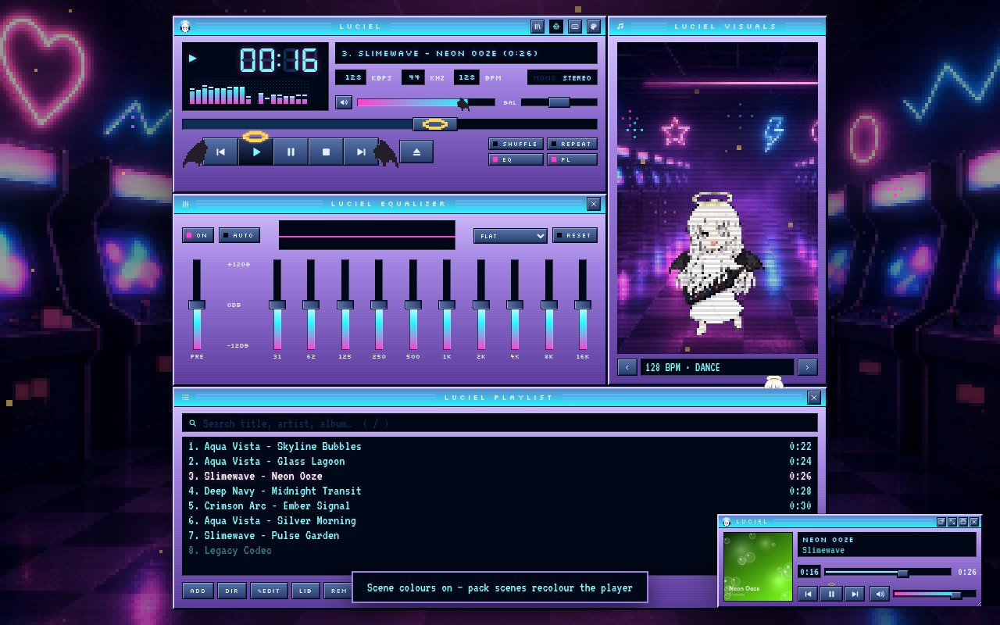
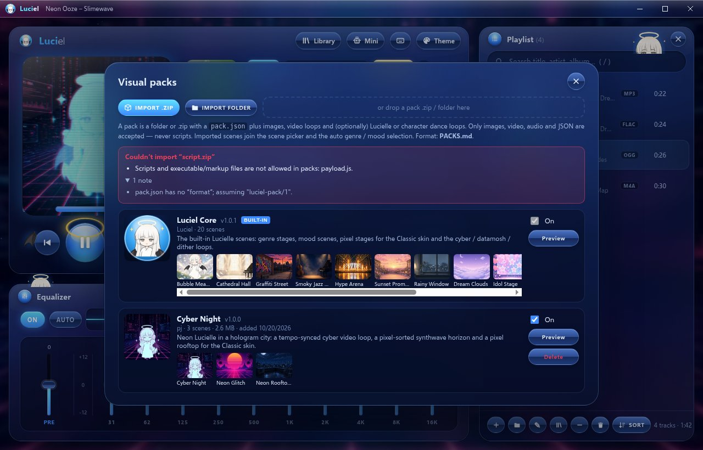
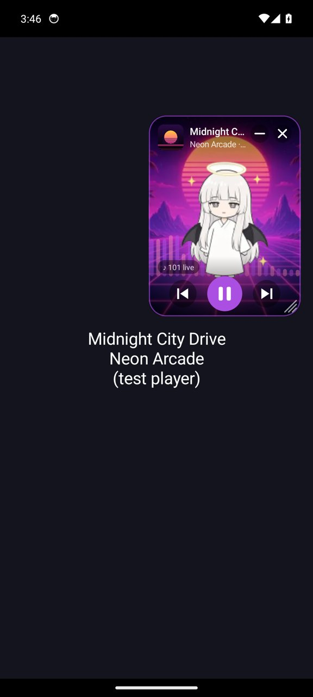
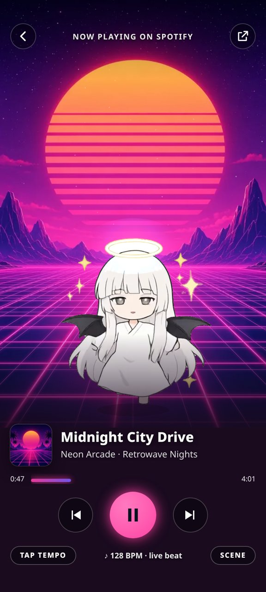

<h1 align="center">Luciel</h1>
<p align="center"><b>An aesthetic music player starring Lucielle, who dances to your music.</b><br>
Windows · Android · Web &nbsp;|&nbsp; Frutiger Aero &amp; Winamp-style skins &nbsp;|&nbsp; reactive scenes &nbsp;|&nbsp; visual packs</p>

<p align="center">
  <a href="https://github.com/luciel-dev/LUCIEL-MUSIC-PLAYER/releases/latest"><b>⬇ Download the latest release</b></a>
</p>

<p align="center"></p>

<table>
<tr>
<td></td>
<td></td>
</tr>
<tr>
<td></td>
<td></td>
</tr>
<tr>
<td></td>
<td></td>
</tr>
</table>

<p align="center">
  
  &nbsp;
  
</p>

## Features

- **Plays (almost) everything** – MP3, FLAC, OGG Vorbis, Opus, M4A/AAC, WAV, WebM; unsupported files (e.g. WMA) are flagged instead of breaking playback.
- **Themes** – 4 palettes (Frutiger Aero Grey, Midnight Blue, Crimson Night, Toxic Slime) × 2 skins: glossy **Aero** glass and **Classic**, a Winamp 2.x-style stacked Main/EQ/Playlist layout with LCD marquee and pixel fonts.
- **Lucielle** – the mascot lives on the stage and in the Classic visuals window as a pixel sprite. She **dances to the tempo** (floats under 90 BPM, grooves at 90–125, full dance loop above 125, locked to the beat), and reacts to the **music itself**: happy at song start, headbang on drops, shocked at sudden hits, yawns in quiet parts, halo spin / clap on build-ups, teary on sad songs, sings along with strong vocals.
- **Reactive scenes** – genre and mood scenes (jazz, hip-hop, classical, pop, synthwave, rock, lo-fi, ambient, sad, hype, romantic, sleepy…), video loops with dithering, datamosh and cyber effects, and pixel-art versions for the Classic skin. Backgrounds pulse with the bass and burst on the beat; Auto picks a scene from genre, tempo and energy.
- **Real BPM detection** – offline onset/autocorrelation analysis with a live beat grid; a BPM tag on the file always wins.
- **Audio** – preamp + 10-band EQ with presets and Auto EQ by genre, balance, spectrum/oscilloscope visualizer, media keys / Media Session.
- **Library** – Songs, Artists, Albums, Genres and Playlists views; album-artist / *feat.* / compilation handling; smart playlists; M3U import/export; play counts.
- **Tag & cover editor** – rename files, edit title/artist/album/track/year/genre/BPM, add covers (file, drag-drop, paste or Lucielle art). Writes real tags for MP3 (ID3v2), FLAC and M4A.
- **Floater** – a small always-on-top mini player that follows your theme and skin; resize it taller for a big-art view with Lucielle dancing.
- **Visual packs** – import a `.zip` or folder of scenes and Lucielle loops; packs can only contain images, video, audio and a `pack.json` (no scripts). Ships with the **Lucielle Styles** pack: *Arcade Angel*, *City Punk* and *Fall Girl*, each with an animated background, pixel version, matching player palette and her own music-event emotes.
- **Windows desktop app** – a real window (minimize, maximize, resize), tray icon, taskbar media buttons, file associations.
- **Android app** – local music with lock-screen/notification controls, plus a **floating Lucielle overlay** that starts when **Spotify** (or any player) plays, reacts to the sound, and controls play/pause/skip.

## Install

Grab the files from the [latest release](https://github.com/luciel-dev/LUCIEL-MUSIC-PLAYER/releases/latest).

### Windows
1. Download **`Luciel-Setup-<version>-x64.exe`** (installer) or **`Luciel-Portable-<version>-x64.exe`** (no install).
2. The app isn't code-signed yet, so Windows SmartScreen may say *"Windows protected your PC"*. Click **More info → Run anyway**.
3. The installer is per-user (no admin needed) and adds Start-menu and desktop shortcuts. Installing a newer version over an older one keeps your library and settings.

### Android (8.0+)
1. Download **`Luciel-<version>-android.apk`** on your phone.
2. Open it and allow **Install unknown apps** for your browser/file manager when Android asks.
3. On first launch, Luciel walks you through permissions:
   - **Music & audio** – to find the songs on your phone.
   - **Notification access** – lets Luciel see what Spotify (or another player) is playing and control it.
   - **Display over other apps** – for the floating Lucielle overlay.
4. Play something in Spotify and Lucielle appears and dances along. Drag her anywhere; tap for controls.

### Visual packs
Download `lucielle-styles-pack.zip` or `example-pack.zip` and import it in **Theme → Visual packs → Import .zip**, or drop the zip onto the player. (The Android app bundles the Lucielle Styles pack already.)

### Web
Unzip `luciel-app.zip` and open `index.html` in Chrome/Edge (or serve the `web/` folder with any static server).

## Repository layout

| Folder | What |
| --- | --- |
| [`web/`](web/) | The player itself – plain HTML/CSS/JS, no build step. See [`web/README.md`](web/README.md) for the full feature list and keyboard shortcuts. |
| [`desktop/`](desktop/) | Electron shell for Windows (and Linux): custom `app://` protocol, frameless window, tray, floater window, native file writes. |
| [`android/`](android/) | Kotlin Android app: WebView UI + Media3 playback, MediaStore library, notification-listener Spotify bridge, overlay service. `testplayer/` is a fake media app for testing the overlay. |
| [`packs/`](packs/) | Manifests and previews of the bundled visual packs (the media zips are release assets). |
| [`tests/`](tests/) | Headless browser test suite for the web app. |
| [`PACKS.md`](PACKS.md) | The visual pack format. |

## Building

### Web
Nothing to build – open `web/index.html` or run `python3 -m http.server` in `web/`.
Art/pack generators live in `web/tools/` (Python 3 + Pillow, ffmpeg).

### Windows desktop (Electron)
Requires Node.js 20+.
```bash
cd desktop
npm ci
npm start                  # run from source (syncs ../web into desktop/app first: npm run sync)
npm run dist:win           # -> dist/Luciel-Setup-<ver>-x64.exe + dist/Luciel-Portable-<ver>-x64.exe
npm run dist:linux         # -> dist/linux-unpacked
```
`tools/sync-app.js` copies `../web` (or `$LUCIEL_WEB`) into `desktop/app` and injects the desktop layer from `desktop/desktop/`.
Building the Windows target on Linux/macOS needs wine.

### Android
Requires JDK 17, the Android SDK (compileSdk 37, build-tools 36) and Node.js (for the web sync step).
```bash
cd android
echo "sdk.dir=/path/to/Android/Sdk" > local.properties
./gradlew assembleDebug                 # debug APK, no signing setup needed
./gradlew testDebugUnitTest             # unit tests
```
Phone-layout web tests (Playwright + Chrome, mocked Android bridge, real audio):
```bash
python3 android/test-web/make-demo-media.py          # 20 tagged demo MP3s -> android/test-web/demo-media (needs ffmpeg + Pillow)
node android/test-web/phone.js                        # 360x780 + 412x915: drill-down, back, safe areas, sheets, audio audit
node android/test-web/smoke.js                        # Android bridge smoke test
```
Debug builds only: `adb shell am broadcast -a com.luciel.player.DEBUG_FLOATER -p com.luciel.player.debug --es palette red --es skin classic --es mode large --es cmd popout`
feeds a fake track into the floating mini player (for emulators whose WebView can't run the page).
A Gradle task runs `tools/sync-web.js` before every build: it copies `../web` into `app/src/main/assets/www`, applies the
Android patches and bundles `../packs/dist/lucielle-styles-pack.zip` if it exists (`LUCIEL_PACKS` to override).

**Release signing** – create your own keystore; it is git-ignored and must never be committed:
```bash
mkdir -p android/keystore
keytool -genkeypair -v -keystore android/keystore/release.jks -alias luciel -keyalg RSA -keysize 4096 -validity 10000
cat > android/keystore/keystore.properties <<'PROPS'
storeFile=release.jks
storePassword=...
keyAlias=luciel
keyPassword=...
PROPS
./gradlew assembleRelease
```

### Tests
See [`tests/README.md`](tests/README.md).

## Visual pack format
A pack is a zip (or folder) with a `pack.json` plus images / video loops / Lucielle dance and emote loops. Scenes declare
which genres, moods and tempos they suit, their palette, effects and how they react to bass and beats.
Full spec: **[PACKS.md](PACKS.md)**.

---
Lucielle and all Luciel art © 2026 pj. All rights reserved.
